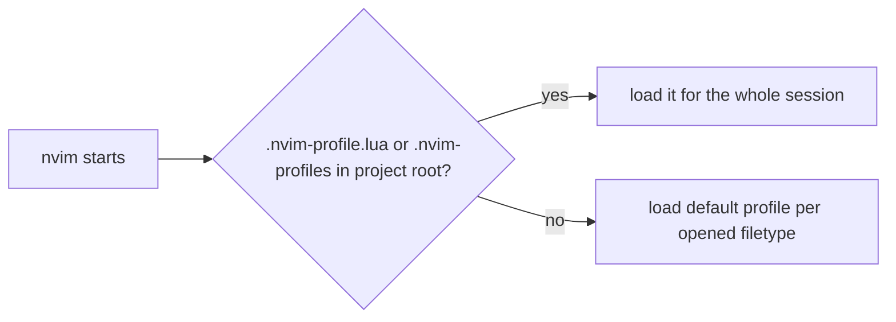

# mise configs

- one `.toml` per neovim profile, listing the LSP servers and formatters that profile expects on `PATH`
- copy into a project as `.mise.toml`, then `mise install`
- `ohmyzsh/.zshrc` runs `mise activate zsh`, so tools follow the current directory

```bash
cp mise/go.toml ~/repos/my-project/.mise.toml
cat mise/go.toml mise/typescript.toml > ~/repos/my-project/.mise.toml
cd ~/repos/my-project && mise install
```

## global tools

- outside a mise project, no version is set and LSP servers fail to start
- set a global default for the languages you want everywhere:

```bash
mise use -g go@latest go:golang.org/x/tools/gopls@latest
```

## profiles



- default: opening `.go` loads `go`, `.rs` loads `rust`, etc. (each profile's `filetypes`)
- override: `.nvim-profile.lua` in project root, see `.nvim-profile*.example.lua`
- `tailwind` has no filetypes, so it only loads via `.nvim-profile.lua`
- `:ListProfiles` shows what is loaded

## tool matrix

| profile    | LSP                      | formatters         | mise config       |
|------------|--------------------------|--------------------|-------------------|
| go         | gopls                    | goimports, golines | `go.toml`         |
| templ      | templ                    | templ, prettierd   | `templ.toml`      |
| rust       | rust_analyzer            | rustfmt            | `rust.toml`       |
| typescript | ts_ls                    | prettierd          | `typescript.toml` |
| html       | html                     | prettierd          | `html.toml`       |
| css        | cssls                    | prettierd          | `css.toml`        |
| tailwind   | tailwindcss              | -                  | `tailwind.toml`   |
| python     | pyright                  | isort, black       | `python.toml`     |
| lua        | lua_ls                   | stylua             | `lua.toml`        |
| elixir     | elixirls                 | -                  | `elixir.toml`     |
| php        | intelephense             | pint               | `php.toml`        |
| svelte     | svelte                   | prettierd          | `svelte.toml`     |
| odin       | ols                      | -                  | `odin.toml`       |
| psql       | postgres-language-server | pg_format          | -                 |

## troubleshooting

- `which gopls` → not found: run `mise install` in the project, or set a global default
- `mise ERROR No version is set for shim` → same
